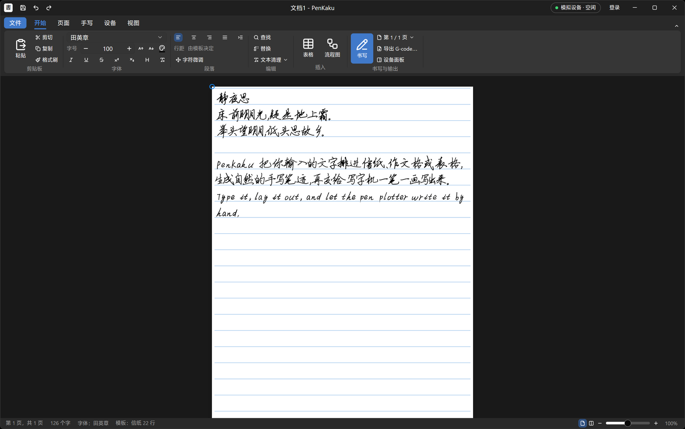
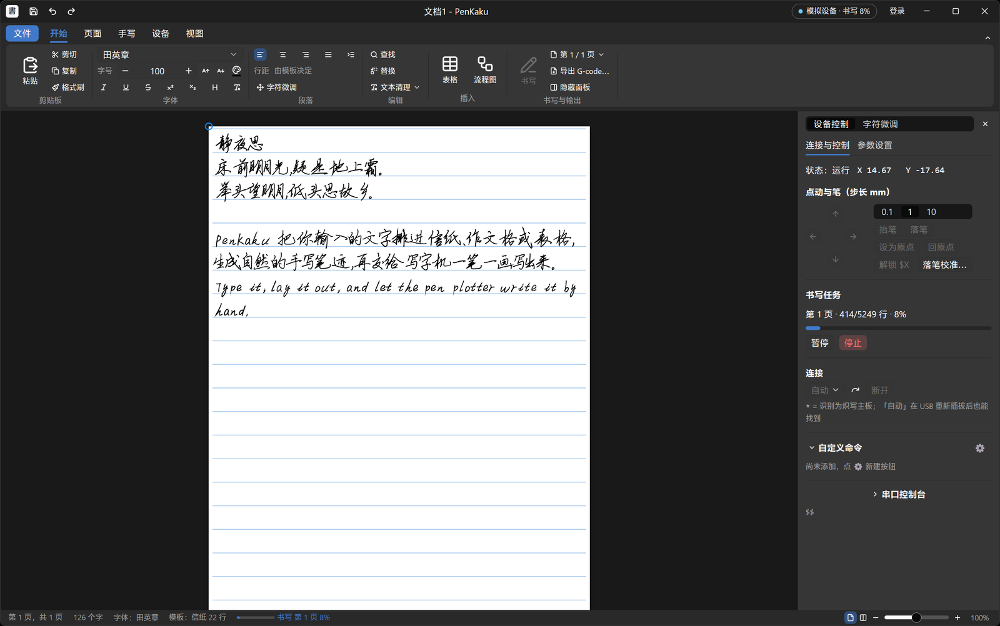
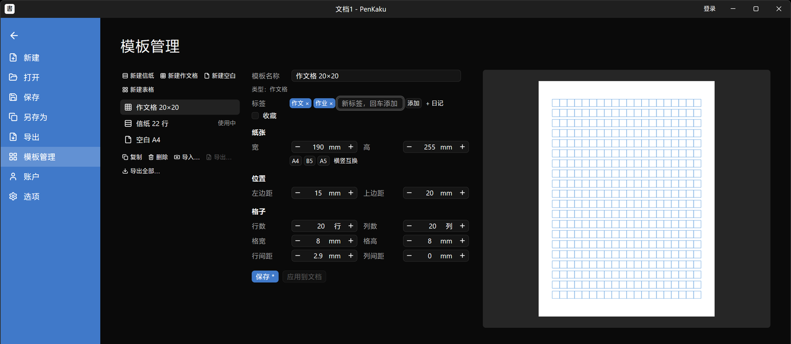
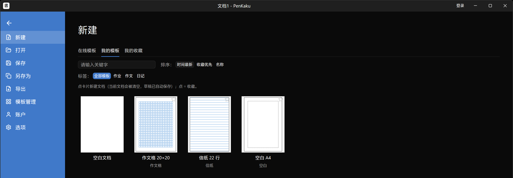

<div align="center">


# PenKaku

**输入、排版，交给写字机一笔一画写出来。**

[](https://github.com/Symb0x76/PenKaku/actions/workflows/ci.yml)
[](https://github.com/Symb0x76/PenKaku/releases)
[](https://www.rust-lang.org)
[](#下载安装)
[](#)
[](#)
[](LICENSE)

[English](README.md) | **简体中文**

</div>

*原名 `chixie-rs`，改名缘由见[重命名提案](docs/rename-proposal.md)。*

一款使用 **Rust** 编写的跨平台开源**笔式写字机（Pen Plotter / Handwriting Machine）上位机软件**，面向基于 **CH340 / GD32** 串口芯片及 **GRBL / Grbl_ESP32** 固件的各类 DIY 开源写字机与商用桌面写字机（亦兼容炽写 ChiXie 主板与生态）。

不同于传统侧重 CNC 铣削或纯矢量线条的 G-code 发送器，本项目打通了 **“富文本长文档排版 → 信纸/作文格/表格模板套打 → 拟真手写风格生成 → 可靠串口流控与断点续写”** 全流程：输入或导入文档后，即可基于单线 SVG 字体生成自然手写笔迹、实时预览并直接驱动写字机书写，或导出矢量 PDF 打印。

> 原生支持 **Windows、macOS 和 Linux**。支持任意标准单线 SVG 字体（含 Inkscape Hershey Text 生态），**完全离线可用**；同时保留对炽写云端字库与 ChiXie3 旧格式的向后兼容。
>
> **支持炽写（ChiXie）账号登录：** 用已有的炽写账号登录后，即可浏览云端字库、获取已收藏的字体并下载到本地字体库。登录是可选的——字体下载后保存在本地，之后完全离线可用。

---

## 界面截图



<table>
  <tr>
    <td width="50%"></td>
    <td width="50%"></td>
  </tr>
  <tr>
    <td align="center">书写中，实时显示进度（模拟设备）</td>
    <td align="center">模板管理：标签由你自己定</td>
  </tr>
</table>



---

## 在开源写字机生态中的定位

在基于 **CH340 + Arduino/ESP32 + GRBL** 的开源写字机生态中（如 `grbl/grbl`、`cprezzi/grbl-servo`、`bdring/Grbl_Esp32`、`bdring/FluidNC`、`bdring/midTbot_esp32`、`bdring/TMC2209_Pen_Laser` 以及各类 CNC Shield V3 / CoreXY / H-Bot DIY 机型），现有开源上位机（如 **GRBL-Plotter**、**Universal G-Code Sender**、**LaserGRBL**、**Candle** 或 WebSerial 工具）大多聚焦于 SVG/DXF 矢量绘图或通用 CNC 加工，普遍缺少**面向中文与混排文档的排版、手写体拟真、信纸/作文格/表格套打**能力；而商用闭源写字机客户端（如 ChiXie3）往往绑定特定品牌硬件、仅限 Windows 且依赖在线账号。

`PenKaku` 旨在成为 **CH340 / GRBL 写字机通用的现代开源 Rust 上位机**：

### 1. 相比常见开源 GRBL 上位机（GRBL-Plotter / UGS / LaserGRBL 等）

- **文档与排版原生支持：** 不再需要“先在 Inkscape 转曲再导出 SVG/G-code”，内置 Word 风格富文本编辑器，支持直接导入 TXT/DOCX 并按信纸、双线、多栏、作文格、复杂合并单元格表格进行页式排版。
- **中文排版与单线手写拟真：** 内置自动避头尾、作文格分词、`SplitMix64` 确定性随机抖动、TPS 字形变形、连笔与落笔轻重变化，让机器写出接近真人的自然笔迹而非机械复制。
- **原生 Rust + GPU 加速体验：** 无需 Java 运行时、.NET Framework 或沉重浏览器容器，单二进制即开即用，三端统一 UI 与原生响应速度。

### 2. 相比传统商业写字机客户端（如 ChiXie3）的优势

| 维度                 | 传统闭源客户端（ChiXie3）                                                        | 本项目（PenKaku）                                                                                                                                                                   |
| -------------------- | -------------------------------------------------------------------------------- | ----------------------------------------------------------------------------------------------------------------------------------------------------------------------------------- |
| **跨平台与无厂商锁** | 仅限 Windows；macOS 屏蔽第三方设备，对未认证主板弹窗警告                         | 原生支持 **Windows / macOS / Linux**，无厂商锁定；支持通用 Grbl / Grbl_ESP32 / 蓝牙 SPP 串口与步进/舵机/电磁铁/自定义抬笔                                                           |
| **手写确定性**       | 排版时临时抽样且不保存，重开或粘贴会导致字迹与缩放漂移                           | 每个字符拥有**稳定 `id`**，结合持久化文档随机种子，局部编辑不打乱其余字符；同文档同字体生成**逐字节一致的 G-code**                                                                  |
| **真离线可用**       | 必须登录才能打字、导入或使用文件菜单，心跳失败会吊销字体                         | **本地优先（Local-first）**，标准 SVG 字体与模板库完全离线运行，不依赖网页或登录保活                                                                                                |
| **长文档性能**       | `QGraphicsItem` 逐字建模（需“大文本模式”），Python TPS 变形较慢                  | 扁平文档模型 + 视口裁剪 + 帧间路径缓存 + **形变字形缓存（`DeformCache`）**；16 页带手写效果文档重排约 **40 ms**，每帧绘制 **3–5 ms**（CI debug 版）                                 |
| **CH340 掉线与续写** | CH340 在电机负载下易掉线且 COM 口变化，断连后难以无缝接续                        | 独立设备 Actor + 字符计数流控 + `?` 轮询与 `Bf:` 丢包重同步；CH340/GD32 掉线按描述自动重连；**G-code 行 ↔ `(页, 字符 id, 笔画)` 映射**支持**行级精确断点续写**；暂停发 `!` 立即停笔 |
| **安全性与隐私**     | `config.ini` **明文保存密码**；使用 Python `pickle` 直接反序列化（代码执行风险） | 密码仅存操作系统安全凭据库（`keyring`）；自研**受限 pickle opcode 只读解析器**（绝不执行代码）                                                                                      |
| **开放标准格式**     | 私有二进制/加密格式（`.cdoc`、Fernet 加密表格模板）                              | **DOCX**（`customXml` 保留种子与字符 id，Word/WPS/LibreOffice 可打开）、**SVG 单线字体**、**SVG 模板**（表格兼支持 **XLSX**）、**TOML**、**ZIP**                                    |
| **编辑与排版完整度** | Ctrl+Z 未实现；无自动避头尾；表格溢出弹窗阻塞编辑                                | 完整命令式**撤销/重做**；真正**自动避头尾**（作文格标点悬挂）；表格溢出非阻塞策略（缩字 / 增行 / 截断）；完整光标与表格 `Tab` 导航                                                  |
| **文档自包含**       | 模板、原点、旋转等分散在全局设置                                                 | 模板、书写原点、页面旋转与单字微调随文档保存，跨机输出完全一致                                                                                                                      |

---

## 相比传统写字机软件多出的特色功能

- **中英文 / 数字分开设置：** 英文与数字可单独配置字号缩放、基线偏移、上下浮动范围与独立字符变形（解决中英混排比例或基线不协调问题）。
- **连笔（Cursive）：** 同一字符内相邻笔画起止点距离较近时，自动将抬落笔转为短曲线衔接，呈现自然快写连带感。
- **字符轻重与随机轻重（`press_jitter`）：** 支持按单字设置 5 档落笔 Z 轴深浅（更轻Ⅱ/Ⅰ、标准、更重Ⅰ/Ⅱ）并叠加随机轻重波动。
- **独立倾斜与尾部控制：** “字形倾斜幅度”与“字形扭曲”拆分独立控制，可配置小尾巴删除概率与长度阈值。
- **落笔校准向导：** 在机器上试写一排不同 Z 轴深度的测试线，直观选出最佳落笔深度并直接写回设备配置。
- **纯本地表格识别（`penkaku-import`）：** 无需云端，直接从**矢量 PDF**（解析绘制指令）、**扫描件或手机照片**（自适应阈值、透视校正与线段聚合）识别网格、合并单元格与内边距。
- **标准 SVG 字库与目录实时监听：** 本地字体采用通用单线 SVG 字体格式（兼容 Inkscape Hershey Text），支持主目录 + 额外共享/只读目录，放入文件即自动刷新，支持单文件或 ZIP 批量导入/导出。
- **自动避头尾与作文格分词：** 真正执行避头尾换行/悬挂标点；作文格可选启用 `jieba-rs` 中文分词保持整词不跨行。
- **空白智能清理：** 一键消除中英文/数字间空格、消除标点与正文间空格。
- **导航窗格与非模态查找替换：** 左侧导航窗格集成全文搜索跳转与全文缺字（`缺字`）定位列表；顶部查找替换栏支持区分大小写与全角/半角等同，替换时保留未改动字符的手写 `id`。
- **格式刷、迷你工具栏与草稿自动保存：** 支持单次/锁定格式刷、选区浮动工具栏、自动保存 `draft.docx`，以及导出可选文字/背景开关的矢量 PDF。
- **炽写账号登录与云端字体：** 在图形界面登录炽写账号（命令行用 `CHIXIE_ACCOUNT` / `CHIXIE_PASSWORD`），即可查看在线字库与已收藏字体，并下载为本地 SVG 字体；“记住密码”只把密码存进系统凭据库。
- **全功能命令行（`penkaku-cli`）：** 支持无界面批量排版生成 G-code、PDF 导出、串口/Telnet 发送、ESP3D TF 卡管理、表格识别以及 `fake-grbl` 仿真抓包服务端。

---

## 支持的硬件与固件

| 类别               | 支持情况                                                                                 | 说明                                                                                                                       |
| ------------------ | ---------------------------------------------------------------------------------------- | -------------------------------------------------------------------------------------------------------------------------- |
| **串口芯片**       | **CH340**、**GD32 Virtual Com Port** 及通用 USB-TTL / 蓝牙 SPP                           | 端口设为“自动”时优先识别 `USB-SERIAL CH340` / `GD32 Virtual Com Port`；支持掉线后按描述自动重连与断点续写                  |
| **控制固件**       | **GRBL**（`grbl` / `grbl-servo`）、**ESP32_Grbl / Grbl_ESP32**（`ChiXie_ESP32_Grbl` 等） | 支持串口（默认 `115200` 波特率）及 ESP32 Wi-Fi Telnet（默认 `23` 端口）与 ESP3D HTTP（TF 卡上传）；Marlin 暂未开放流式发送 |
| **抬落笔机构**     | **步进抬笔**、**舵机抬笔（Servo）**、**电磁铁抬笔**、**自定义指令（CustomZ）**           | 支持独立设置写字速度与空走速度、落笔后驻留（`G4 P`）、轴映射（XY 互换 / 反向）、笔锋测试（实验性）                         |
| **已实测参考机型** | CH340 + Grbl_ESP32 1.3a 主板（约 300 × 300 mm 行程）                                     | 建议保持端口为“自动”，在电机大负载触发 CH340 瞬断时可自动找回端口                                                          |

---

## 技术栈

| 领域                 | 选型与说明                                                                                                                                                                             |
| -------------------- | -------------------------------------------------------------------------------------------------------------------------------------------------------------------------------------- |
| **语言与工程**       | **Rust**（Edition 2024，最低要求 `1.98`），Cargo Workspace 多 crate 架构（8 个独立 crate）                                                                                             |
| **桌面 GUI 框架**    | **`gpui-kit`（`gpui` / `gpui-pre 0.3.11` + `gpui-component 0.9.0`）**，GPU 硬件加速渲染（Windows DX11/Vulkan、macOS Metal、Linux Vulkan/Wayland/X11）                                  |
| **文档与办公格式**   | 自研轻量 OOXML 引擎（`zip` + `quick-xml` + `encoding_rs`）处理 DOCX 与 TXT（含 GB18030）；`calamine` 读取 Excel；`rust_xlsxwriter` 导出 Excel；`lopdf` 读取矢量 PDF 指令与生成矢量 PDF |
| **中文排版与分词**   | 自研排字引擎与避头尾规则；`jieba-rs`（feature `segment`）提供作文格中文分词                                                                                                            |
| **图形与文件监听**   | `image` 处理 PNG/JPEG 预览与光栅表格识别；`notify` 实时监听字体与模板库目录变化；`embed-resource` 嵌入 Windows 应用图标                                                                |
| **硬件通信与并发**   | `serialport` 串口通信（CH340 / GD32 / 蓝牙 SPP）；TCP/Telnet 与 ESP3D HTTP；`async-channel` 驱动单设备 Actor 状态机                                                                    |
| **加解密与兼容导入** | `reqwest`（`rustls`）可选对接字体接口；`aes` / `cbc` / `hmac` / `sha2` / `base64`；自研只读 pickle opcode 解析器安全导入旧版 `.cx`/`.cset`                                             |
| **系统集成与配置**   | `toml` / `serde` / `serde_json` 读写配置；`directories` 获取跨平台标准目录；`keyring` 对接系统凭据库                                                                                   |
| **命令行与测试**     | `clap`（derive）构建 CLI；`proptest` 属性模糊测试、Golden G-code 回归测试、内置仿真设备与 `PENKAKU_AUTOTEST=1` 全流程 GUI 自动化测试                                                   |

---

## 文件位置说明

### 1. 源码工程结构（Repository Layout）

```text
penkaku/
├── Cargo.toml                     # Workspace 成员、共享依赖与编译 profile 配置
├── crates/
│   ├── penkaku-core/            # 核心库：SVG 字体库、字体混用/修复、排版、手写/连笔/变形、配置 Settings、可选云端 API 与旧版 config.ini/.cset 导入
│   ├── penkaku-doc/             # 文档模型：稳定字符 id、格式 run、段落、命令模式撤销/重做、DOCX/TXT/.chx 读写、查找替换
│   ├── penkaku-template/        # 页面模板：信纸/双线/分栏/作文格/表格模板、单元格填充、SVG 库、ZIP/XLSX 互导、.cx 导入
│   ├── penkaku-import/          # 本地表格识别：从矢量 PDF、扫描件与照片提取表格边框与合并单元格
│   ├── penkaku-output/          # 输出流水线：之/弓路径规划、旋转/原点变换、多色换笔分段、G-code 生成、矢量 PDF 导出
│   ├── penkaku-device/          # 设备通信：串口/Telnet/ESP3D 传输、Grbl 流控与重同步、CH340 断连恢复 Actor、局域网发现
│   ├── penkaku-gui/             # 桌面客户端：gpui 界面、Ribbon/Backstage、文档编辑器、模板编辑器、设备面板、模拟后端与各平台资源（resources/）
│   └── penkaku-cli/             # 命令行客户端 penkaku-cli 与 fake-grbl 抓包仿真器
└── docs/                          # 项目文档、重命名提案、协议与架构资料
```

### 2. 运行时本机文件位置

程序遵循各操作系统规范目录，不向系统目录或注册表写入杂项：

| 数据类型                                         | Windows                                      | macOS                                                 | Linux                                                    | 说明                                                                      |
| ------------------------------------------------ | -------------------------------------------- | ----------------------------------------------------- | -------------------------------------------------------- | ------------------------------------------------------------------------- |
| **主配置** (`settings.toml`)                     | `%APPDATA%\penkaku\config\settings.toml`     | `~/Library/Application Support/penkaku/settings.toml` | `~/.config/penkaku/settings.toml`（`$XDG_CONFIG_HOME`）  | 保存设备参数、页面默认设置、手写风格与界面偏好（**不含密码**）            |
| **自动保存草稿** (`draft.docx`)                  | 与 `settings.toml` 同目录                    | 与 `settings.toml` 同目录                             | 与 `settings.toml` 同目录                                | 编辑器改动后自动保存；兼容读取旧版 `draft.chx`                            |
| **运行时缓存** (`previews/`, `template_assets/`) | 与 `settings.toml` 同目录                    | 与 `settings.toml` 同目录                             | 与 `settings.toml` 同目录                                | 存放字体预览图与当前模板背景 PNG 资源                                     |
| **本地字体库**（默认）                           | `%USERPROFILE%\Documents\penkaku\Fonts\`     | `~/Documents/penkaku/Fonts/`                          | `~/Documents/penkaku/Fonts/`（`$XDG_DOCUMENTS_DIR`）     | 每个字体一个 `.svg` 文件；可在 **选项 › 字体** 迁移路径并添加额外共享目录 |
| **本地模板库**（默认）                           | `%USERPROFILE%\Documents\penkaku\Templates\` | `~/Documents/penkaku/Templates/`                      | `~/Documents/penkaku/Templates/`（`$XDG_DOCUMENTS_DIR`） | 每个模板一个 `.svg` 文件；可在 **选项 › 模板** 迁移路径并添加额外只读目录 |
| **账号密码**                                     | Windows 凭据管理器                           | macOS 钥匙串（Keychain）                              | Linux Secret Service（D-Bus）                            | 仅在登录云端字库时存入系统凭据库（服务名 `penkaku`），永不明文落盘        |
| **离线演示模式数据**                             | `%TEMP%\penkaku-demo\`                       | `$TMPDIR/penkaku-demo/`                               | `/tmp/penkaku-demo/`                                     | 启用 `PENKAKU_FAKE=1` 时独立隔离存放，不触碰真实设置与库目录              |
| **旧版 ChiXie3 导入源**                          | `%USERPROFILE%\ChiXie3\conf\`                | —                                                     | —                                                        | 可选导入 `config.ini`、`.cx` 模板与 `.cset` 设备参数                      |

---

## 下载安装

GitHub Actions 每次 CI 都会在 `windows-latest`、`macos-latest`、`ubuntu-latest` 原生构建并上传 `penkaku-<OS>-debug` 产物（含图形端 `penkaku` 与命令行 `penkaku-cli`）：

- **Windows：** 解压获取 `penkaku.exe` 和 `penkaku-cli.exe`，直接运行。若系统未自动识别 CH340 串口，请先安装 WCH 官方 CH340 驱动。
- **macOS：** 解压 `penkaku-macOS.tar.gz`，将 `penkaku.app` 拖入“应用程序”。因未进行 Apple 公证，首次启动需右键点击应用选择 **打开**（或执行 `xattr -dr com.apple.quarantine`）。
- **Linux：** 解压 `penkaku-Linux.tar.gz`，运行 `./penkaku/install.sh` 安装到 `~/.local` 并注册桌面菜单与图标（全局安装可使用 `PREFIX=/usr/local`）；使用串口请确保当前用户在 `dialout`（或发行版对应串口）用户组中。

应用图标由 [make_icons.py](crates/penkaku-gui/resources/icon/make_icons.py) 从 [OriginIcon.png](docs/OriginIcon.png) 生成，生成产物已随仓库提交。

---

## 从源码构建与测试

需要 **Rust 1.98+**（Edition 2024）。

```sh
cargo build --workspace
cargo run -p penkaku-gui
```

Linux（Debian / Ubuntu）需先安装系统开发依赖：

```sh
sudo apt-get install -y pkg-config libudev-dev libdbus-1-dev libfontconfig-dev libfreetype-dev \
  libxkbcommon-dev libxkbcommon-x11-dev libwayland-dev libx11-xcb-dev libxcb1-dev \
  libvulkan-dev mesa-vulkan-drivers libzstd-dev
```

运行测试与静态检查：

```sh
cargo test --workspace
cargo clippy --workspace --all-targets -- -D warnings
```

---

## 无硬件/无账号快速试用

使用离线演示模式启动桌面客户端（内置演示字体与模拟 Grbl 设备，无需真实写字机，数据隔离在临时目录）：

```sh
PENKAKU_FAKE=1 cargo run -p penkaku-gui
```

常用环境变量：

| 变量                                  | 作用                                                                    |
| ------------------------------------- | ----------------------------------------------------------------------- |
| `PENKAKU_FAKE=1`                      | 启用离线演示后端与模拟 Grbl 设备，设置与库文件写入临时目录              |
| `PENKAKU_AUTOTEST=1`                  | 在演示模式下自动运行全流程脚本化 GUI 验收测试，输出 `AUTOTEST_*` 后退出 |
| `PENKAKU_SIM_DELAY_MS`                | 模拟设备每行 G-code 的执行延迟（毫秒，默认 `3`）                        |
| `PENKAKU_PERF=1`                      | 输出排版与每帧绘制耗时统计                                              |
| `CHIXIE_ACCOUNT`、`CHIXIE_PASSWORD` | 为命令行字体相关指令提供登录凭据                                        |

---

## 命令行（`penkaku-cli`）

执行 `penkaku-cli --help` 查看完整参数，核心子命令如下：

| 命令                                     | 说明                                                                            |
| ---------------------------------------- | ------------------------------------------------------------------------------- |
| `ports`、`discover`                      | 列出可用串口（标注 CH340/GD32），或扫描局域网无线主板                           |
| `send`、`stream`                         | 向主板发送单条指令，或流式发送 G-code 文件（支持串口与 `--ip` Telnet）          |
| `sd`                                     | 通过 ESP3D HTTP 管理主板 TF 卡文件（`ls` / `upload` / `rm` / `run` / `status`） |
| `fonts`、`font-check`                    | 列出本地/已收藏字体、浏览在线字体库或诊断字体下载解密                           |
| `write`                                  | 将文本排版并生成 G-code（支持输出到标准输出、文件或直接发送到主板）             |
| `pdf`                                    | 将文本排在 A4 横线纸上导出为矢量 PDF（支持 `--no-ink` / `--no-background`）     |
| `detect-table`                           | 本地识别 PDF 或图片（PNG/JPEG）中的表格边框与合并单元格                         |
| `style-template`、`import-style`         | 生成手写风格 TOML 模板，或从 ChiXie3 的 `config.ini` 转换风格配置               |
| `calibrate`、`capture-diff`、`fake-grbl` | 字体尺寸校准、G-code 对比与模拟 Grbl TCP 服务端                                 |

---

## 相关文档

- [docs/rename-proposal.md](docs/rename-proposal.md)：项目更名为 PenKaku 的缘由与重命名清单
- [docs/chixie3-features.md](docs/chixie3-features.md)：ChiXie3 兼容功能对照与实现状态
- [docs/reimplementation-plan.md](docs/reimplementation-plan.md)：架构演进与里程碑记录
- [docs/protocol.md](docs/protocol.md)：GRBL / ESP32 设备通信协议与 G-code 规范
- [docs/hardware-checklist.md](docs/hardware-checklist.md)：真机硬件联调检查清单

## 许可证

PenKaku 以 [GNU 通用公共许可证第 3 版（仅限该版本）](LICENSE)（`GPL-3.0-only`）发布。
